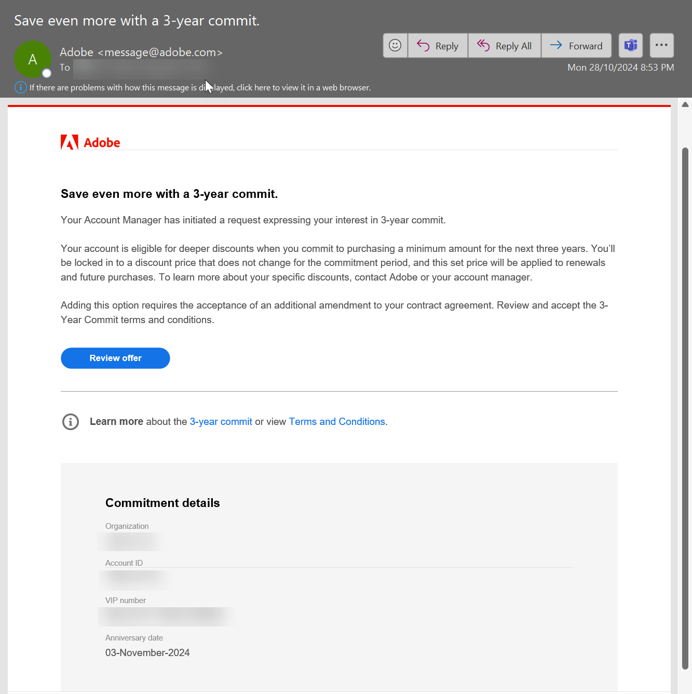
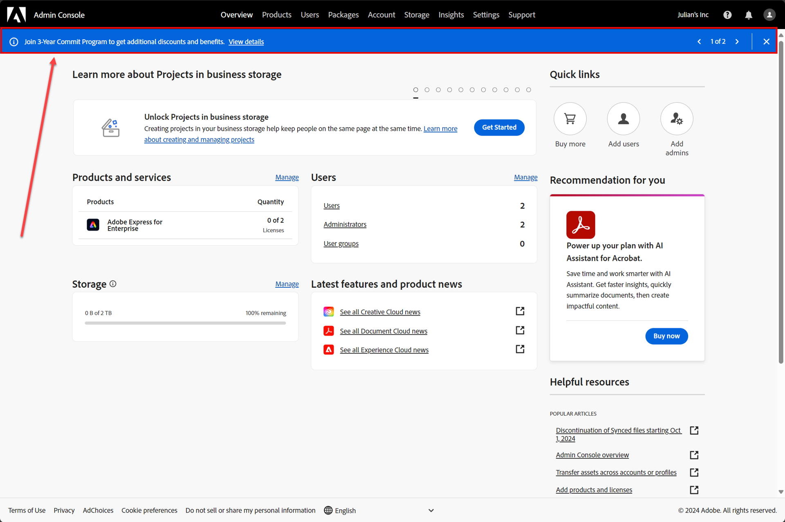
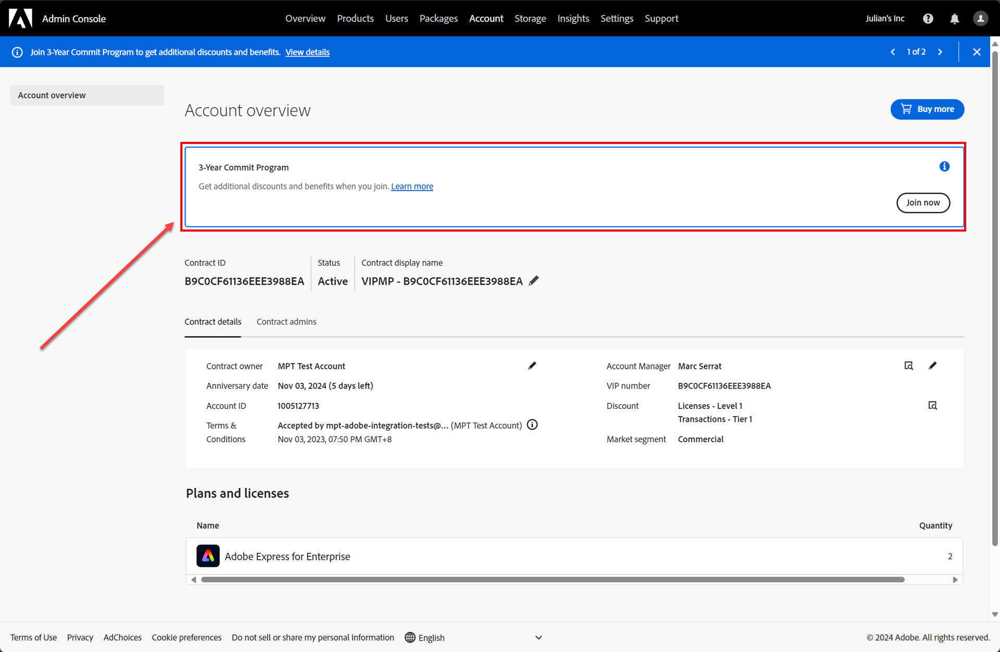

# How do I accept my 3-year commitment invitation?

When SoftwareOne sends you an invitation for your 3-year commitment (3YC), you receive an email from Adobe and a notification in your Adobe Admin Console.

This invitation includes information about the 3YC program.

### Invitation eligibility

To receive and accept the invitation, you must have access to the Adobe Admin Console. Additionally:

* You must be an active administrator. If you are not an active administrator when the 3YC invitation is sent, you will not receive it.
* If there are multiple administrators in the Adobe Admin Console, all of them will receive the invitation and can take action on it.
* 3YC invitations are sent to administrators based on their roles. Therefore, it is not possible to include or exclude specific individuals from receiving the invitation.

### Accepting the invitation

Accepting the invitation involves reviewing the program details, including terms and conditions, and confirming the acceptance.


If you didn't receive the invitation email or have trouble accessing it, you can still complete the acceptance process directly in the Adobe Admin Console. In such cases, skip to step 3 in the following procedure.


**To accept the invitation**

1. Open the 3-year commitment email from Adobe, usually sent from message@adobe.com.
2. Select **Review offer**. You'll be directed to the Adobe Admin Console.

<figure><figcaption>
A sample 3-year commit email from Adobe.
</figcaption></figure>

3. Sign in to the console. Then, do one of the following:
   * In the 3-year commit message at the top, select **View details**.

<figure><figcaption>
An invitation message in the Admin Console.
</figcaption></figure>

* Go to **Account overview** and select **Join now**.

<figure><figcaption>
The Account overview page in the Admin Console.
</figcaption></figure>

4. On the **Accept 3 Year Commit** page:
   1. Under **Accept Terms and Conditions**, select the checkbox to confirm that you have read the terms and conditions.
   2. Select **Accept 3 Year Commit**. Note that the option is enabled only after selecting the checkbox.

<figure><figcaption>
Accept 3 year commit page in the Admin Console
</figcaption></figure>

### Next steps

After you accept the invitation, SoftwareOne updates your 3-year commitment details in the SoftwareOne Marketplace.

* **Reach your minimum within 30 days.** Your 3-year commitment becomes active when you hold at least the minimum quantities you committed to. The smallest possible commitment is 10 licenses or 1000 consumables. Adobe gives you 30 days after you accept to reach your minimum.
* **Orders waiting for your acceptance continue.** While an invitation is waiting, orders for your account pause in **Querying** status. After you accept, open each paused order and select **Process**.
* **Your prices change.** When your 3-year commitment is active, prices are adjusted to your committed discount level.

You can check your 3-year commitment at any time on the **Adobe** tab of your agreement. For more details, see [How do I view 3-year commitment details in Marketplace?](how-do-i-view-3-year-commitment-details-in-marketplace.md).
