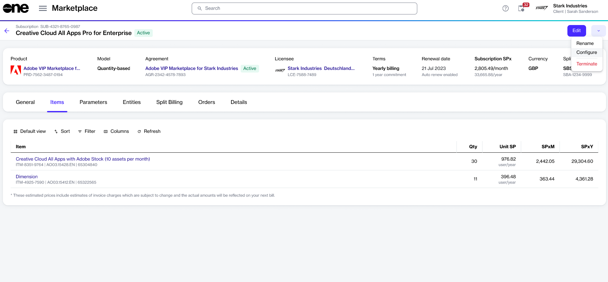

# Change Adobe subscription auto-renewal

You can turn automatic renewal on or off for an Adobe subscription by placing a configuration order. This helps you decide whether the subscription renews on your anniversary date.

* **Disable** auto-renewal if you don't want the subscription to renew. Your licenses stay active until your anniversary date, and then the subscription expires. This is also the way to stop a subscription that is outside the 14-day return window.
* **Enable** auto-renewal if you turned it off and now want the subscription to renew.

### Prerequisites

You cannot place a configuration order on the day before your anniversary date or on the anniversary date itself (US Pacific time). For more details, see [Key dates and deadlines](../key-dates-and-deadlines.md).

### Change auto-renewal for an Adobe subscription



**Open the required subscription**

To open the subscription:

1. Go to **Marketplace** > **Subscriptions**.
2. Select the required subscription.
3. On the subscription details page, select the dropdown arrow , then choose **Configure**.

<figure><figcaption>
The Configure option on the subscription details page.
</figcaption></figure>



**Submit the configuration order**

In the guided Configuration order flow, complete the following steps:

1. **Auto-renewal** – Choose **Disable** or **Enable**, then select **Next**.
2. **Order details** – Enter the order reference information, then select **Next**.
3. **Review order** – Review the details, then select **Place order**.
4. **Summary** – Review your order summary, then select **View details** to open the order details page, or select **Close**.



### Next steps

Your configuration order is processed automatically. When it completes:

* If you disabled auto-renewal, your licenses stay active until your anniversary date. Then the subscription expires, and you are not billed further.
* If you enabled auto-renewal, the subscription renews on your anniversary date at its **Renewal quantity**.

### Related tasks


[set-up-a-new-adobe-agreement.md](../set-up-your-account/set-up-a-new-adobe-agreement.md)



[add-products-to-your-adobe-agreement.md](add-products-to-your-adobe-agreement.md)



[transfer-your-adobe-account-to-softwareone.md](../set-up-your-account/transfer-your-adobe-account-to-softwareone.md)



[increase-adobe-license-quantity.md](increase-adobe-license-quantity.md)



[reduce-adobe-license-quantity.md](reduce-adobe-license-quantity.md)



[terminate-and-return-adobe-licenses.md](../returns-and-termination/terminate-and-return-adobe-licenses.md)



[cancel-adobe-agreement.md](../returns-and-termination/cancel-adobe-agreement.md)



[return-adobe-renewal-order.md](../returns-and-termination/return-adobe-renewal-order.md)

