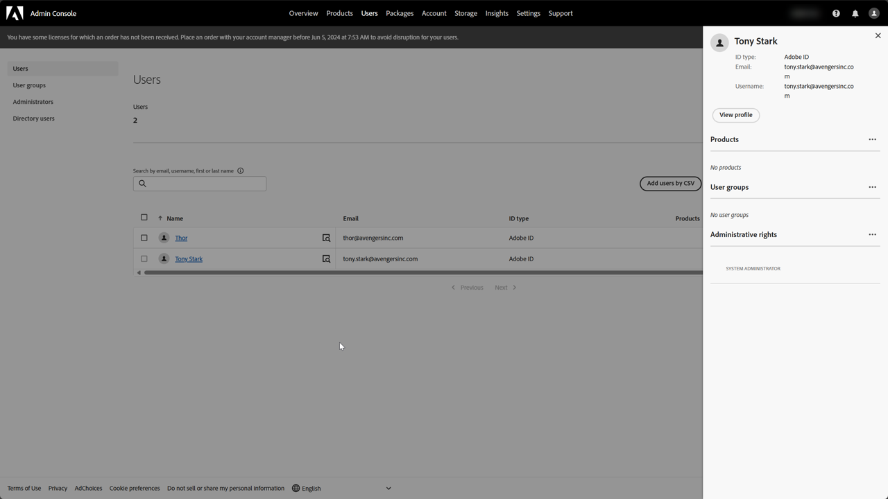
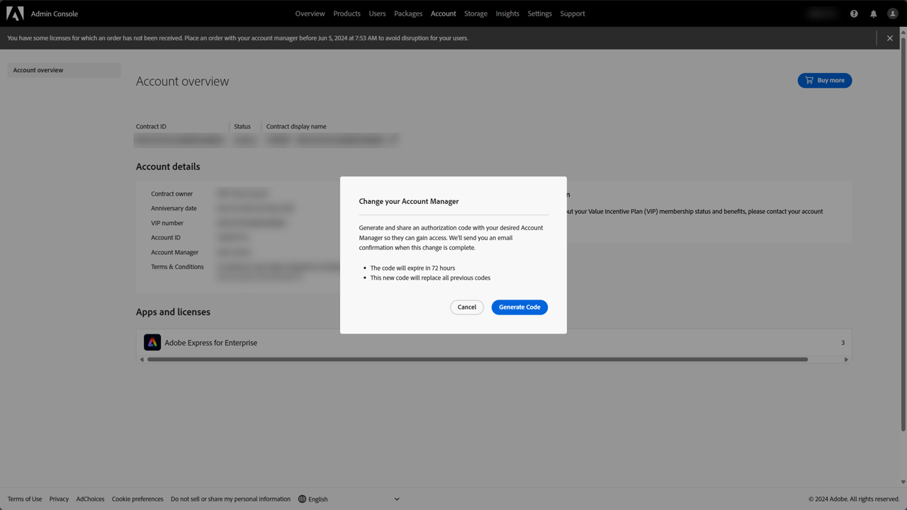
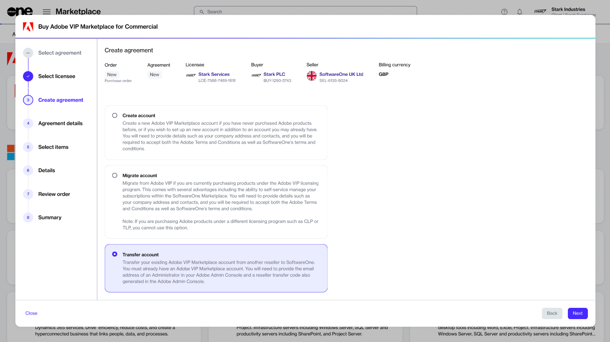
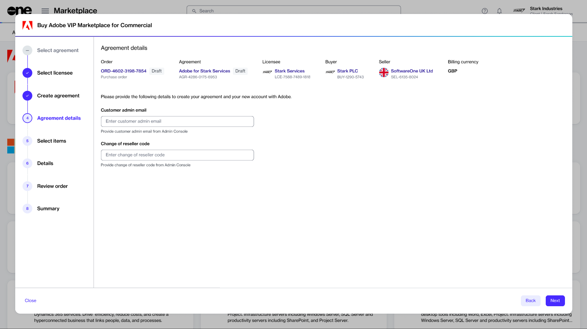

# Transfer your Adobe account to SoftwareOne

You can transfer your Adobe account to SoftwareOne if you currently buy Adobe licenses through another reseller. This helps you manage your Adobe subscriptions and orders in the SoftwareOne Marketplace.

Adobe allows its VIP Marketplace customers to switch from their current reseller to a new one. This process is known as reseller transfer.

Once the transfer is complete, SoftwareOne becomes your new reseller, managing your Adobe subscriptions and orders.


* Reseller transfers are allowed only for the Adobe VIP Marketplace. Licensing programs such as the Value Incentive Plan (VIP), Cumulative Licensing Program (CLP), Transactional Licensing Program (TLP), and Enterprise Term Licensing Agreement (ETLA) don't permit a change of reseller.
* The Marketplace Platform supports reseller transfers for all supported Adobe VIP Marketplace products, including Commercial, Education, Government, and Large Government Agencies.
* Transfer Government and Large Government Agency accounts with their own product: **Adobe VIP Marketplace for Government** or **Adobe VIP Marketplace for Large Government Agencies**.


### Prerequisites

Before starting the reseller change process, make sure you have the following details from your Adobe Admin Console:

* Your system administrator's email address.
* Your reseller change code.

How to find the email address of your system administrator


As this process is managed by Adobe, see their official documentation for up-to-date instructions.


1. Sign in to the Admin Console.
2. Select the **Users** tab.

<figure><figcaption></figcaption></figure>

3. In the left sidebar, select **Administrators**.
4. Choose any administrator from the list and note their email address.

How to generate an approval or reseller change code


As this process is managed by Adobe, see their official documentation for up-to-date instructions.


1. Sign in to the Admin Console.
2. Navigate to the **Account** tab in the top navigation bar.
3. Under **Account details**, select the edit icon next to the **Account Manager** name.
4. In the **Change your Account Manager** dialog box, select **Generate Code** to generate the approval code.

<figure><figcaption></figcaption></figure>

5. Note the generated code and use it within 7 days.

### Transfer your Adobe account to SoftwareOne

All reseller transfers require a new agreement and a new purchase order in the Marketplace. The order includes your existing Adobe subscriptions automatically. You cannot add more items to a transfer order, but you can add them with a change order after the transfer completes.

To start the process:

1. Sign in to the Marketplace Platform.
2. Go to **Catalog** > **Products**.
3. Select **Adobe VIP Marketplace**. Then, on the product details page, review the information, and select **Buy now**.
4. In the guided purchase flow, complete the following steps:
   1. Select **Create agreement**.
   2. Choose a licensee or [create a new one](../../../modules-and-features/settings/licensees/create-licensees.md). Then, select **Next**.
   3.  Choose **Transfer account** and select **Next**.

       
<figure><figcaption>
The option to transfer your account.
</figcaption></figure>

   4.  Provide your system administrator's email address and the approval code from the Admin Console. Make sure that the approval code is valid. If the code has expired, you must generate a new one from the Admin Console. Select **Next**.

       
<figure><figcaption>
The options to enter the email address and reseller code.
</figcaption></figure>

   5. Select **Next** to continue to the **Details** step. This current step is view-only.
   6. Provide reference details for the order, then select **Next**.
   7. Read the terms and conditions and the privacy statement. Select **Place order**.
   8. Review your order summary, then select **View details** to open the order details page, or select **Close**.

### Next steps

Once we process the order and change the reseller, we will notify you. You can check the status of your order on the order details page.

When the transfer completes, auto-renewal is turned on for all your transferred subscriptions. Check your subscriptions, and turn auto-renewal off for any that you don't want to renew. For more details, see [Change Adobe subscription auto-renewal](../manage-subscriptions/change-adobe-subscription-auto-renewal.md).

### Related tasks


[set-up-a-new-adobe-agreement.md](set-up-a-new-adobe-agreement.md)



[increase-adobe-license-quantity.md](../manage-subscriptions/increase-adobe-license-quantity.md)



[reduce-adobe-license-quantity.md](../manage-subscriptions/reduce-adobe-license-quantity.md)



[change-adobe-subscription-auto-renewal.md](../manage-subscriptions/change-adobe-subscription-auto-renewal.md)



[terminate-and-return-adobe-licenses.md](../returns-and-termination/terminate-and-return-adobe-licenses.md)



[cancel-adobe-agreement.md](../returns-and-termination/cancel-adobe-agreement.md)



[return-adobe-renewal-order.md](../returns-and-termination/return-adobe-renewal-order.md)

