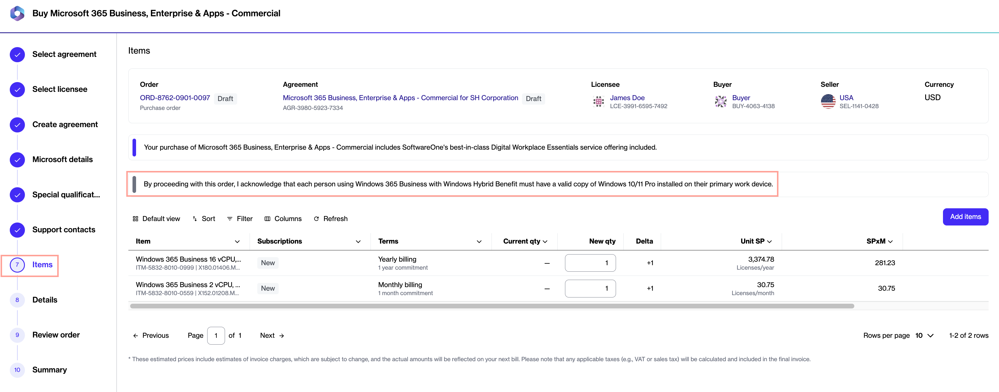
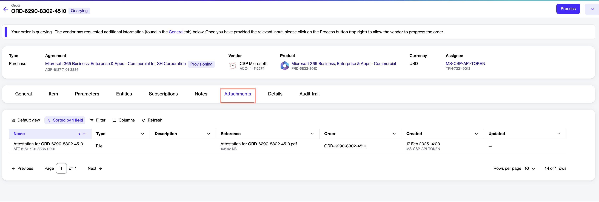

# What is offer attestation?

Offer attestation is a verification process that requires clients purchasing through the Marketplace to acknowledge specific terms and conditions before placing an order.

Currently, the only offer that requires attestation is **Windows 365 Business with Windows Hybrid Benefit**. When ordering it, you must acknowledge that each person using the software has a valid copy of Windows 10/11 Pro installed on their primary work device.&#x20;

This verification helps ensure compliance with Microsoft's licensing requirements and must be completed before the order can be placed.

### Acknowledge an offer attestation

When you order an item that falls under the **Hybrid Use** category, the following message appears on the **Items** page:

"By proceeding with this order, I acknowledge that each person using Windows 365 Business with Windows Hybrid Benefit must have a valid copy of Windows 10/11 Pro installed on their primary work device."&#x20;

The attestation message appears for purchase orders and change orders that include items requiring attestation.

<figure><figcaption>
Offer attestation message during the ordering process.
</figcaption></figure>

By selecting **Next** on the **Items** page, you confirm that you accept the attestation.&#x20;

After you place the order, a PDF is available on the **Attachments** tab of the agreement details and order details pages. The PDF contains the attestation details, including the name of the person who accepted the attestation and the date and time it was confirmed.&#x20;

The following image shows an example:

<figure><figcaption>
Use the <strong>Attachments</strong> tab to view the attestation PDF.
</figcaption></figure>

You can also see the attestation details through the [audit trail](../../../../modules-and-features/settings/audit-trail.md).&#x20;
